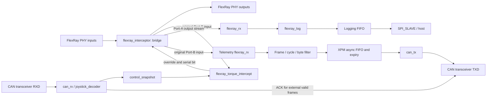

# 🔐 Safety & Legal Disclaimer

This code is for research and development only.
Use in live vehicles must comply with local laws and safety standards.
Any damage or consequences are at the user’s responsibility.


# FlexRay Interceptor (XA7S50 · Xilinx Automotive)

Reference implementation of a **FlexRay MITM (man-in-the-middle) interceptor/logger** based on the Xilinx XA7S50 (Spartan-7 Automotive).  
The design places two FlexRay PHYs between vehicle bus segments to provide **transparent pass-through**, while the FPGA performs **frame detection, validation, and modification**.  

[](#license)
[](#-development-environment)
[](#-hardware-overview)


## ✨ Features

- **MITM pass-through**: Transparent bridge between Port-A (vehicle) and Port-B (DADC)
- **Frame-level processing**: BSS/TSS/FSS sync → header/payload parsing → CRC check
- **Selective modification**: On-the-fly field or payload rewrite rules
- **Reliable logging**: Timestamp + raw/PDU dual logging, backpressure support
- **Host I/O**: FT4232HAQ  Channel A (JTAG) , Channel B SPI  for log streaming


## 🧰 Hardware Overview

- **FPGA**: Xilinx **XA7S50** 
- **FlexRay PHY**: NXP **TJA1081TS** × 4 *(Port-A/Port-B/Port-C/Port-D)*
  - Interface: `TXD`, `TXEN`, `RXD`
- **I/O/Debug**: **FT4232HA** (JTAG + MPSSE/SPI)


## 🛠 Development Environment

- **Vivado**: 2024.2  
- **Language**: VHDL  
- **JTAG**: FT4232HA (MPSSE) Vivado Hardware Manager  

<br>

# 🛠 How to use
1. Clone
   - git clone -b lrmaster-v2 https://github.com/dolson8874/flexray-interceptor.git

2. Open th Project
   - Launch Vivado → **File ▸ Open Project…**

3. Create HDL Wrapper (for Block Design) 
   - In **Sources**, open the Block Design
   - **Tools ▸ Create HDL Wrapper...**
   - Select **Let Vivado manage wrapper and auto-update** → **OK**
   
4. Set as Top
   - In **Sources**, right-click the generated `bendbeam_wrapper.vhd` → **Set as Top**.

5. Run Synthesis / Implementation / Bitstream
   - Flow Navigator: **Run Synthesis** (optionally Open Synthesized Design)
   - **Run Implementation**
   - **Generate Bitstream**

6. Generate a Memory Configuration File (.mcs / .bin)
   - **File ▸ Generate Memory Configuration File…**
   - **Format: MCS (common for SPI flashes) or BIN**
   - **Memory Part**: mt25ql128-spi-x1_x2_x4
   - **Interface**: SPIx4
   - **Load bitstream**
   - Choose an output path and Generate.
   - Check overwrite 

<br><br>

# FPGA Pin map
| Name        | XA7S50 Pin | Part        | Signal/Notes |
| ----------- | ---------- | ----------- | ------------ |
| CLK         | R2         | OSC 12MHz   |              |
| RESET out   | J6         |             |              |
| DONE        | V8         | LED         | D1           |
| TCK         | D9         | FT4232HAQ A | ADBUS0       |
| TDI         | R9         | FT4232HAQ A | ADBUS1       |
| TDO         | T8         | FT4232HAQ A | ADBUS2       |
| TMS         | T9         | FT4232HAQ A | ADBUS3       |
| SCLK        | M167       | FT4232HAQ B | BDBUS0       |
| MOSI        | M17        | FT4232HAQ B | BDBUS1       |
| MISO        | M18        | FT4232HAQ B | BDBUS2       |
| NCS         | N18        | FT4232HAQ B | BDBUS3       |
| CDBUS0      | B13        | FT4232HAQ C | CDBUS0       |
| CDBUS1      | A13        | FT4232HAQ C | CDBUS1       |
| CDBUS2      | B14        | FT4232HAQ C | CDBUS2       |
| CDBUS3      | A13        | FT4232HAQ C | CDBUS3       |
| CDBUS4      | B15        | FT4232HAQ C | CDBUS4       |
| CDBUS5      | A15        | FT4232HAQ C | CDBUS5       |
| CDBUS6      | B16        | FT4232HAQ C | CDBUS6       |
| CDBUS7      | A16        | FT4232HAQ C | CDBUS7       |
| DDBUS0      | E12        | FT4232HAQ D | DDBUS0       |
| DDBUS1      | D12        | FT4232HAQ D | DDBUS1       |
| DDBUS2      | C13        | FT4232HAQ D | DDBUS2       |
| DDBUS3      | C14        | FT4232HAQ D | DDBUS3       |
| DDBUS4      | B17        | FT4232HAQ D | DDBUS4       |
| DDBUS5      | A17        | FT4232HAQ D | DDBUS5       |
| DDBUS6      | C17        | FT4232HAQ D | DDBUS6       |
| DDBUS7      | B18        | FT4232HAQ D | DDBUS7       |
| LED1        | V16        | LED         | D7           |
| LED2        | U15        | LED         | D8           |
| LED3        | T15        | LED         | D9           |
| LED4        | R15        | LED         | D10          |
| LED5        | V17        | LED         | D11          |
| FR0\_TXD    | K4         | TJA1081     | TXD          |
| FR0\_RXD    | L4         | TJA1081     | RXD          |
| FR0\_TXEN   | K3         | TJA1081     | TXEN         |
| FR1\_TXD    | K2         | TJA1081     | TXD          |
| FR1\_RXD    | K1         | TJA1081     | RXD          |
| FR1\_TXEN   | L1         | TJA1081     | TXEN         |
| FR2\_TXD    | K6         | TJA1081     | TXD          |
| FR2\_RXD    | L6         | TJA1081     | RXD          |
| FR2\_TXEN   | L5         | TJA1081     | TXEN         |
| FR3\_TXD    | M4         | TJA1081     | TXD          |
| FR3\_RXD    | M6         | TJA1081     | RXD          |
| FR3\_TXEN   | M5         | TJA1081     | TXEN         |
| CAN\_TX     | M3         | ATA6561     | TXD          |
| CAN\_RX     | M2         | ATA6561     | RXD          |
| CAN\_STBY   | M1         | ATA6561     | STBY         |
| RELAY\_DRV0 | G16        | FR0 - FR1   |              |
| RELAY\_DRV1 | G17        | FR2 - FR3   |              |
| GPIO1       | N5         | SMAW200-20C | 20           |
| GPIO2       | N4         | SMAW200-20C | 19           |
| GPIO3       | P2         | SMAW200-20C | 18           |
| GPIO4       | P1         | SMAW200-20C | 17           |
| GPIO6       | R1         | SMAW200-20C | 15           |
| GPIO7       | R3         | SMAW200-20C | 14           |
| GPIO8	     | T2	      | SMAW200-20C | 13           |
| GPIO9	     | T1	      | SMAW200-20C | 12           |
| GPIO10	     | U1		   | SMAW200-20C | 11           |
| GPIO11	     | U3		   | SMAW200-20C | 10           |
| GPIO12	     | U2		   | SMAW200-20C | 9            |
| GPIO13	     | V3		   | SMAW200-20C | 8            |
| GPIO14	     | V2		   | SMAW200-20C | 7            |

## Local CAN telemetry development



CAN telemetry is disabled by default in both `flexray_can_telemetry_0.ENABLED`
and `joystick_decoder_0.ENABLE_CAN_TELEMETRY`. No telemetry identifier or data
mapping has been selected for the vehicle yet. Test identifiers are test vectors.

The observation path reads the original Port-B input through
`flexray_interceptor_0/rx`. `flexray_rx` checks header/frame CRCs, then the
collector selects a frame ID, a masked cycle value, and up to eight payload
bytes. `BYTE_0` becomes CAN byte 0, transmitted first; unused CAN bytes are zero.
Short payloads are rejected. This path does not backpressure the FlexRay bridge.

An XPM asynchronous FIFO transfers complete messages from 80 MHz to the CAN
clock domain. Full-queue samples are dropped, with a saturating counter.
Source-clock timestamps cross with XPM Gray synchronization; expired queued
messages are discarded, with a separate counter. Defaults permit one capture
per 8,000,000 source clocks and expire samples after 8,000,000 source clocks
(100 ms at 80 MHz). A transmitter waiting for bus idle also has a bounded wait.

Before enabling telemetry, configure `FRAME_ID`, `CYCLE_MASK`, `CYCLE_VALUE`,
`CAN_ID`, `BYTE_COUNT`, `BYTE_0` through `BYTE_7`, `MIN_CAPTURE_CYCLES`, and
`MAX_AGE_CYCLES` on `flexray_can_telemetry_0` in the block design. Then enable
both generics and regenerate the block design outputs. The selected IDs, fields,
period, and bus must be confirmed before board validation.

The transmitter supports standard 11-bit classic CAN data frames with DLC 0–8,
CRC/stuffing, external ACK checking, arbitration-loss release, and bounded
retries. Requests while busy cannot overwrite the active frame. The integrated
receiver suppresses ACK/delivery for its own transmission. Extended IDs, remote
frames, CAN FD, active error flags, and complete ISO error-confinement/bus-off
behavior are not implemented. Simulation coverage is not protocol certification.
The existing MMCM CAN clock is retained: approximately 6.382978 MHz, or
797.872 kbps with eight clocks per CAN bit.

Run the local simulations with Vivado 2024.2 installed:

```powershell
./tests/run_all.ps1
# Reproduce the original cantx defects (expected to fail four diagnostics):
./tests/run_can_tx_diagnostics.ps1 -SourceRef cantx
```

For local full-design synthesis, placement, routing, CDC, DRC, utilization, and
timing reports, use the following commands. They create separate projects under
the ignored `tests/design_*.sim` directories, and do not generate a bitstream
or program a board. The second command enables telemetry only in its temporary
verification project. Reports belong to that configuration, not automatically
to an existing bitstream.

```powershell
& C:/Xilinx/Vivado/2024.2/bin/vivado.bat -mode batch -nojournal -nolog -notrace -source scripts/verify_design.tcl -tclargs 0
& C:/Xilinx/Vivado/2024.2/bin/vivado.bat -mode batch -nojournal -nolog -notrace -source scripts/verify_design.tcl -tclargs 1
```

The timing change registers the selected override bit before the frame CRC XOR
network. Cycle-modulo-12 phase checks use a direct six-bit decode, exhaustively
checked against integer remainder for all 64 cycle values and both used phases.
Steady-state serial outputs are compared against `cb31f52` with the
same disabled LCA test mode by `run_flexray_equivalence.ps1`. Comparison starts
after the initial cache warmup; fault-handling changes have separate tests.
The clock-wide false path between related MMCM
clocks was removed so those transfers remain timed. External I/O timing still
requires the board/transceiver timing requirements; internal timing closure
alone does not validate the external interfaces.

CAN control outputs now cross through `control_snapshot_0`: a toggle/acknowledge
mailbox holds torque, status, and enable as one 24-bit word until the 80 MHz
domain captures it. Intermediate updates coalesce into the next snapshot.
Reset asserts asynchronously and releases synchronously in each domain.
Only the first toggle synchronizer stages have false-path exceptions; the
bundled data path and its skew are bounded to 12.5 ns. Mailbox atomicity,
latest-value delivery, reset, and recovery are tested separately.

Verification including the review fixes below and disabled LCA tests, on
2026-11-03, Vivado 2024.2, `xa7s50csga324-1Q`:

| Configuration | Routed WNS | Routed WHS | Setup/hold failing endpoints |
| --- | ---: | ---: | ---: |
| Telemetry disabled | +0.741 ns | +0.015 ns | 0 / 0 |
| Telemetry enabled in verification project | +0.477 ns | +0.015 ns | 0 / 0 |

Those implementation reports are in `tests/design_0_r3.sim/` and
`tests/design_1_r3.sim/`, from separate full synthesis/implementation runs
(`verify_design.tcl -tclargs 0 _r3` / `1 _r3`). Both
methodology reports have zero findings. CDC reports retain CDC-15 warnings
for the mailbox/FIFO clock-enable structures; request/acknowledgement behavior,
data delay, and bus skew were checked rather than suppressing those warnings.
The DRC reports have no errors but retain warnings, including logging BRAM
asynchronous controls, LUT pairing, and nets without routable loads.
External inputs/outputs still lack complete board-level timing
constraints. No bitstream or hardware validation is included in these results.

Simulation coverage includes the original four CAN defects, full
CAN wire/CRC/stuff/ACK and error handling, queue filtering/order/rate/expiry,
FlexRay-to-CAN integration plus existing CAN control reception, serial-output
steady-state equivalence after cache warmup over 16 input FlexRay frames,
and atomic control snapshots/reset recovery.

## Review fixes and disabled LCA tests

The second review's CRC preservation, frame snapshots, per-header torque update,
and CAN length validation changes are recorded in [CHANGES.md](CHANGES.md).

`TEST_LCA` is false. Low-speed LCA test patches are disabled; the existing
production LKAS/HUD branches remain. The cycle-3 replacement branch remains
pass-through, and its unused replacement-byte construction was removed.

Enable revocation is accepted during each frame header, without depending on
receipt of a later cycle-3 frame. A payload already being modified completes
with its CRC before a new header adopts changed permission/synchronization.
Four-bit counters use modular arithmetic across cycle wraparound.
Each enabled header captures the latest torque, including after synchronization
recovery and when cycle-3 frames are missing. The command stays fixed throughout
the payload and CRC. Cache validity and HUD commands use the same frame snapshot
policy. The outgoing CRC applies the original/modified CRC difference to the
received CRC, preserving input errors.

CRC-validated reference frames (`0x1F`, cycle modulo 4 = 0, marker B25 = 0x60)
refresh synchronization. Reference state and the cycle-1 cached data expire
independently after `SYNC_TIMEOUT_CYCLES` (default 8,000,000 clocks, 100 ms at
80 MHz). A corrupt/short relevant frame or inconsistent reference counter
invalidates synchronization/cache. Neutral reference bytes 0x23/0x28 permit
reacquisition. Cycle-1 modification waits until its own valid cache exists.
Other frame phases and held completion flags cannot keep old state alive.

`flexray_log_dispatch` retains one active and one pending frame and drains the
pending entry when logging becomes idle, even without a new frame arrival.
When both slots are occupied it drops new arrivals in order; a saturating
drop counter is available at its module port (not connected to the host).

CAN HUD health requires application CRC success, DLC 8, and a changed counter.
Rejected packets cannot advance counter history. Warm reset clears the CAN
watchdog and FlexRay bit/sampling phase state.

`tests/run_review_regressions.ps1` covers enable revocation with missing cycle 3,
CRC/counter loss, independent reference/cache expiry, counter wraparound,
warm-reset recovery, disabled LCA patches, pending log drain/order, overflow,
concurrent arrival/dispatch, CRC-valid completion after mid-frame revocation,
and fresh-command capture after reacquisition. The integration suite also checks corrupt-HUD
health rejection/recovery and an expired CAN watchdog across warm reset.

