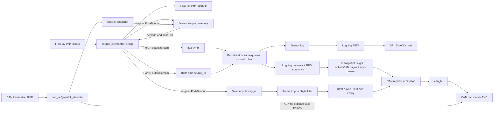

# 🔐 Safety & Legal Disclaimer

This code is for research and development only.
Use in live vehicles must comply with local laws and safety standards.
Any damage or consequences are at the user’s responsibility.


# FlexRay Interceptor (XA7S50 · Xilinx Automotive)

Reference implementation of a **FlexRay MITM (man-in-the-middle) interceptor/logger** based on the Xilinx XA7S50 (Spartan-7 Automotive).  
The design places two FlexRay PHYs between vehicle bus segments to provide **transparent pass-through**, while the FPGA performs **frame detection, validation, and modification**.  

[](#license)
[](#-development-environment)
[](#-hardware-overview)


## ✨ Features

- **MITM pass-through**: Transparent bridge between Port-A (vehicle) and Port-B (DADC)
- **Frame-level processing**: BSS/TSS/FSS sync → header/payload parsing → CRC check
- **Selective modification**: On-the-fly field or payload rewrite rules
- **Buffered logging**: CRC-validated bidirectional frames over SPI, per-direction queues and backpressure support
- **Host I/O**: FT4232HAQ  Channel A (JTAG) , Channel B SPI  for log streaming


## 🧰 Hardware Overview

- **FPGA**: Xilinx **XA7S50** 
- **FlexRay PHY**: NXP **TJA1081TS** × 4 *(Port-A/Port-B/Port-C/Port-D)*
  - Interface: `TXD`, `TXEN`, `RXD`
- **I/O/Debug**: **FT4232HA** (JTAG + MPSSE/SPI)


## 🛠 Development Environment

- **Vivado**: 2024.2  
- **Language**: VHDL  
- **JTAG**: FT4232HA (MPSSE) Vivado Hardware Manager  

<br>

# 🛠 How to use
1. Clone
   - git clone -b lrmaster-v2 https://github.com/dolson8874/flexray-interceptor.git

2. Open th Project
   - Launch Vivado → **File ▸ Open Project…**

3. Create HDL Wrapper (for Block Design) 
   - In **Sources**, open the Block Design
   - **Tools ▸ Create HDL Wrapper...**
   - Select **Let Vivado manage wrapper and auto-update** → **OK**
   
4. Set as Top
   - In **Sources**, right-click the generated `bendbeam_wrapper.vhd` → **Set as Top**.

5. Run Synthesis / Implementation / Bitstream
   - Flow Navigator: **Run Synthesis** (optionally Open Synthesized Design)
   - **Run Implementation**
   - **Generate Bitstream**

6. Generate a Memory Configuration File (.mcs / .bin)
   - **File ▸ Generate Memory Configuration File…**
   - **Format: MCS (common for SPI flashes) or BIN**
   - **Memory Part**: mt25ql128-spi-x1_x2_x4
   - **Interface**: SPIx4
   - **Load bitstream**
   - Choose an output path and Generate.
   - Check overwrite 

<br><br>

# FPGA Pin map
| Name        | XA7S50 Pin | Part        | Signal/Notes |
| ----------- | ---------- | ----------- | ------------ |
| CLK         | R2         | OSC 12MHz   |              |
| RESET out   | J6         |             |              |
| DONE        | V8         | LED         | D1           |
| TCK         | D9         | FT4232HAQ A | ADBUS0       |
| TDI         | R9         | FT4232HAQ A | ADBUS1       |
| TDO         | T8         | FT4232HAQ A | ADBUS2       |
| TMS         | T9         | FT4232HAQ A | ADBUS3       |
| SCLK        | M167       | FT4232HAQ B | BDBUS0       |
| MOSI        | M17        | FT4232HAQ B | BDBUS1       |
| MISO        | M18        | FT4232HAQ B | BDBUS2       |
| NCS         | N18        | FT4232HAQ B | BDBUS3       |
| CDBUS0      | B13        | FT4232HAQ C | CDBUS0       |
| CDBUS1      | A13        | FT4232HAQ C | CDBUS1       |
| CDBUS2      | B14        | FT4232HAQ C | CDBUS2       |
| CDBUS3      | A13        | FT4232HAQ C | CDBUS3       |
| CDBUS4      | B15        | FT4232HAQ C | CDBUS4       |
| CDBUS5      | A15        | FT4232HAQ C | CDBUS5       |
| CDBUS6      | B16        | FT4232HAQ C | CDBUS6       |
| CDBUS7      | A16        | FT4232HAQ C | CDBUS7       |
| DDBUS0      | E12        | FT4232HAQ D | DDBUS0       |
| DDBUS1      | D12        | FT4232HAQ D | DDBUS1       |
| DDBUS2      | C13        | FT4232HAQ D | DDBUS2       |
| DDBUS3      | C14        | FT4232HAQ D | DDBUS3       |
| DDBUS4      | B17        | FT4232HAQ D | DDBUS4       |
| DDBUS5      | A17        | FT4232HAQ D | DDBUS5       |
| DDBUS6      | C17        | FT4232HAQ D | DDBUS6       |
| DDBUS7      | B18        | FT4232HAQ D | DDBUS7       |
| LED1        | V16        | LED         | D7           |
| LED2        | U15        | LED         | D8           |
| LED3        | T15        | LED         | D9           |
| LED4        | R15        | LED         | D10          |
| LED5        | V17        | LED         | D11          |
| FR0\_TXD    | K4         | TJA1081     | TXD          |
| FR0\_RXD    | L4         | TJA1081     | RXD          |
| FR0\_TXEN   | K3         | TJA1081     | TXEN         |
| FR1\_TXD    | K2         | TJA1081     | TXD          |
| FR1\_RXD    | K1         | TJA1081     | RXD          |
| FR1\_TXEN   | L1         | TJA1081     | TXEN         |
| FR2\_TXD    | K6         | TJA1081     | TXD          |
| FR2\_RXD    | L6         | TJA1081     | RXD          |
| FR2\_TXEN   | L5         | TJA1081     | TXEN         |
| FR3\_TXD    | M4         | TJA1081     | TXD          |
| FR3\_RXD    | M6         | TJA1081     | RXD          |
| FR3\_TXEN   | M5         | TJA1081     | TXEN         |
| CAN\_TX     | M3         | ATA6561     | TXD          |
| CAN\_RX     | M2         | ATA6561     | RXD          |
| CAN\_STBY   | M1         | ATA6561     | STBY         |
| RELAY\_DRV0 | G16        | FR0 - FR1   |              |
| RELAY\_DRV1 | G17        | FR2 - FR3   |              |
| GPIO1       | N5         | SMAW200-20C | 20           |
| GPIO2       | N4         | SMAW200-20C | 19           |
| GPIO3       | P2         | SMAW200-20C | 18           |
| GPIO4       | P1         | SMAW200-20C | 17           |
| GPIO6       | R1         | SMAW200-20C | 15           |
| GPIO7       | R3         | SMAW200-20C | 14           |
| GPIO8	     | T2	      | SMAW200-20C | 13           |
| GPIO9	     | T1	      | SMAW200-20C | 12           |
| GPIO10	     | U1		   | SMAW200-20C | 11           |
| GPIO11	     | U3		   | SMAW200-20C | 10           |
| GPIO12	     | U2		   | SMAW200-20C | 9            |
| GPIO13	     | V3		   | SMAW200-20C | 8            |
| GPIO14	     | V2		   | SMAW200-20C | 7            |

## Local CAN telemetry development



FlexRay data telemetry remains disabled in `flexray_can_telemetry_0.ENABLED`.
The saved block design enables logging diagnostics on standard CAN ID `0x1FA`
and the shared transmitter in `joystick_decoder_0.ENABLE_CAN_TELEMETRY`.
The HDL enable generic defaults remain false. No vehicle FlexRay-to-CAN data
mapping has been selected; diagnostics do not enable that collector.
Test telemetry identifiers are test vectors.

The observation path reads the original Port-B input through
`flexray_interceptor_0/rx`. `flexray_rx` checks header/frame CRCs, then the
collector selects a frame ID, a masked cycle value, and up to eight payload
bytes. `BYTE_0` becomes CAN byte 0, transmitted first; unused CAN bytes are zero.
Short payloads are rejected. This path does not backpressure the FlexRay bridge.

An XPM asynchronous FIFO transfers complete messages from 80 MHz to the CAN
clock domain. Full-queue samples are dropped, with a saturating counter.
Source-clock timestamps cross with XPM Gray synchronization; expired queued
messages are discarded, with a separate counter. Defaults permit one capture
per 8,000,000 source clocks and expire samples after 8,000,000 source clocks
(100 ms at 80 MHz). A transmitter waiting for bus idle also has a bounded wait.

Before enabling telemetry, configure `FRAME_ID`, `CYCLE_MASK`, `CYCLE_VALUE`,
`CAN_ID`, `BYTE_COUNT`, `BYTE_0` through `BYTE_7`, `MIN_CAPTURE_CYCLES`, and
`MAX_AGE_CYCLES` on `flexray_can_telemetry_0` in the block design. Then enable
both generics and regenerate the block design outputs. The selected IDs, fields,
period, and bus must be confirmed before board validation.

The transmitter supports standard 11-bit classic CAN data frames with DLC 0–8,
CRC/stuffing, external ACK checking, arbitration-loss release, and bounded
retries. Requests while busy cannot overwrite the active frame. The integrated
receiver suppresses ACK/delivery for its own transmission. Extended IDs, remote
frames, CAN FD, active error flags, and complete ISO error-confinement/bus-off
behavior are not implemented. Simulation coverage is not protocol certification.
The existing MMCM CAN clock is retained: approximately 6.382978 MHz, or
797.872 kbps with eight clocks per CAN bit.

Run the local simulations with Vivado 2024.2 installed:

```powershell
./tests/run_all.ps1
# Payload-length boundaries and stuck-low recovery only:
./tests/run_bounds_tests.ps1
# SPI mode-0 byte streaming, CS aborts, and reset recovery:
./tests/run_spi_tests.ps1
# Forwarding reset and complete log bytes using the actual FIFO IP model:
./tests/run_frontend_tests.ps1
# Reproduce the original cantx defects (expected to fail four diagnostics):
./tests/run_can_tx_diagnostics.ps1 -SourceRef cantx
```

For local full-design synthesis, placement, routing, CDC, DRC, utilization, and
timing reports, use the following commands. They create separate projects under
the ignored `tests/design_*.sim` directories, and do not generate a bitstream
or program a board. Both configurations enable diagnostic CAN; the second
command additionally enables frame telemetry in its temporary verification
project. Reports belong to that configuration, not automatically
to an existing bitstream.

```powershell
& C:/Xilinx/Vivado/2024.2/bin/vivado.bat -mode batch -nojournal -nolog -notrace -source scripts/verify_design.tcl -tclargs 0
& C:/Xilinx/Vivado/2024.2/bin/vivado.bat -mode batch -nojournal -nolog -notrace -source scripts/verify_design.tcl -tclargs 1
```

The timing change registers the selected override bit before the frame CRC XOR
network. Cycle-modulo-12 phase checks use a direct six-bit decode, exhaustively
checked against integer remainder for all 64 cycle values and both used phases.
Steady-state serial outputs are compared against `cb31f52` with the
same disabled LCA test mode by `run_flexray_equivalence.ps1`. Comparison starts
after the initial cache warmup; fault-handling changes have separate tests.
The clock-wide false path between related MMCM
clocks was removed so those transfers remain timed. External I/O timing still
requires the board/transceiver timing requirements; internal timing closure
alone does not validate the external interfaces.

CAN control outputs now cross through `control_snapshot_0`: a toggle/acknowledge
mailbox holds torque, status, and enable as one 24-bit word until the 80 MHz
domain captures it. Intermediate updates coalesce into the next snapshot.
Reset asserts asynchronously and releases synchronously in each domain.
Only the first toggle synchronizer stages have false-path exceptions; the
bundled data path and its skew are bounded to 12.5 ns. Mailbox atomicity,
latest-value delivery, reset, and recovery are tested separately.

Verification including the review fixes below and disabled LCA tests, on
2026-11-03, Vivado 2024.2, `xa7s50csga324-1Q`:

| Configuration | Routed WNS | Routed WHS | Setup/hold failing endpoints |
| --- | ---: | ---: | ---: |
| Telemetry disabled | +0.685 ns | +0.023 ns | 0 / 0 |
| Telemetry enabled in verification project | +0.227 ns | +0.020 ns | 0 / 0 |

Those implementation reports are in `tests/design_0_front.sim/` and
`tests/design_1_front.sim/`, from separate full synthesis/implementation runs
(`verify_design.tcl -tclargs 0 _front` / `1 _front`). Both
methodology reports have zero findings. CDC reports retain CDC-15 warnings
for the mailbox/FIFO clock-enable structures; request/acknowledgement behavior,
data delay, and bus skew were checked rather than suppressing those warnings.
The DRC reports have no errors but retain warnings, including logging BRAM
asynchronous controls, LUT pairing, and nets without routable loads.
External inputs/outputs still lack complete board-level timing
constraints. No bitstream or hardware validation is included in these results.

Simulation coverage includes the original four CAN defects, full
CAN wire/CRC/stuff/ACK and error handling, queue filtering/order/rate/expiry,
FlexRay-to-CAN integration plus existing CAN control reception, serial-output
steady-state equivalence after cache warmup over 16 input FlexRay frames,
and atomic control snapshots/reset recovery.

Local VHDL simulations enable XSim runtime range checking (`--rangecheck`).
The boundary suite covers every seven-bit payload length (0 through 127 words),
active interception of long frames up to 254 bytes, CRC rejection, and recovery
after a 1 ms dominant input. BSS counters track a modulo-10 byte phase; the
interceptor's full data-position counter includes header, maximum payload, and CRC.

SPI logging uses mode 0 with a prefetched TX byte. If CS goes high before all
eight clock cycles complete, the partial RX byte is discarded and the same TX
byte is retried from its first bit at the next CS assertion. A next byte already
prefetched after a complete byte also survives a CS boundary. Clocks while CS is
high do not complete bytes or request more FIFO data. An empty TX stream sends
zero filler; warm reset clears buffered SPI state. The SPI suite checks partial
lengths 1 through 7, continuous transfers, FIFO consumption, empty TX, and reset.

The logging FIFO is configured as Standard_FIFO with an unregistered output.
The frontend reads and captures its output before offering a stable byte to SPI;
the last buffered byte remains available after the FIFO becomes empty. Reset
flushes the prefetch and drives both forwarding outputs and enables to idle high.
The frontend suite generates the actual FIFO simulation model from the saved XCI
and checks reset, stalled consumption, and exact log frames including final CRC.

## Bidirectional logging and diagnostic CAN (2026-11-09)

Both forwarding outputs are decoded for logging: `s_tx_0` is DADC to the BCM
side (after interception), and `s_tx_1` is the BCM side to DADC. The BCM-side
segment may contain other transmitting ECUs. Each direction has 32 complete
frame slots plus a shared active logger request. The packed records use
distributed RAM (LUTRAM); the depth generic permits 1..64 slots. Round-robin arbitration keeps
the selected frame and its direction stable until accepted; a full frame queue
drops the new frame without stalling the FlexRay bridge. Output order preserves
each direction's order, not a globally timestamped receive order.

The existing byte format is retained: `CA A0` for DADC (wire bus 2, sunnypilot
source 6), `CA 80` for BCM-side traffic (wire bus 0, sunnypilot source 4),
followed by the existing header, duplicated flags/cycle, payload, and CRC.
A record is payload length + 12 bytes, up to 266 bytes. The host parser must
accept both markers and retain partial records across Bulk reads. The markers
can occur inside payload and the direction byte is not covered by FlexRay CRC.
No timestamp, sequence number, or diagnostics bytes were added to SPI.
The user's reported working SPI setting is 7.5 MHz; 10 MHz is unverified.

The saved block design enables standard 11-bit CAN ID `0x1FA`, DLC 8, for logging
diagnostics. The normal FlexRay data collector remains disabled. At 80 MHz,
one coherent statistics snapshot is captured every 80,000,000 clocks (1 second).
Eight packed pages from that snapshot pass through the existing asynchronous CAN
queue, with a one-second message expiry, then a fair request arbiter and the
shared `can_tx`. Backpressure/full queues never stall the FlexRay bridge.
The CAN clock/bitrate and existing transmitter protocol limitations described
above are unchanged. No new bitstream has been programmed.

| CAN data bytes | Encoding |
| --- | --- |
| 0 | version 2 in upper nibble, page 0..7 in lower nibble (`20`..`27` hex) |
| 1 | snapshot sequence, wraps 255 to 0; first snapshot after reset is 0 |
| 2..7 | six contiguous snapshot bytes; no reserved bytes |

Reassemble `snapshot[page*6:page*6+6] = data[2:8]` for all eight pages, then
decode the 48 bytes as twelve little-endian uint32 values. A value can cross a
page boundary. Version 1's one-value-per-page draft is not this wire format.

| Item index (byte offset = index * 4) | Value |
| --- | --- |
| 0 | DADC CRC-valid frame count, including queue-full drops |
| 1 | BCM-side CRC-valid frame count, including queue-full drops |
| 2 | DADC frame-queue drop count |
| 3 | BCM-side frame-queue drop count |
| 4 | DADC queue high water in low 16 bits, BCM queue high water in high 16 bits |
| 5 | Current byte FIFO occupancy, excludes prefetch byte |
| 6 | Maximum byte FIFO occupancy |
| 7 | Byte FIFO full-state entries (not full clock cycles) |
| 8 | DADC log byte demand, including queue drops and 12-byte record overhead |
| 9 | BCM-side log byte demand, including queue drops and record overhead |
| 10 | Valid log bytes accepted by SPI prefetch, excluding idle zero filler |
| 11 | Completed SPI bytes, including filler, counted from `SPI_SLAVE.DOUT_VLD` |

Event counts saturate at `FFFFFFFF` hex. Byte totals (items 8..11) wrap modulo
2^32 so continuous rate measurements do not freeze after about 76 minutes at
full 7.5 MHz service. All counters/high-water values reset to zero;
queue peaks are 0..32 with the default depth and the byte FIFO capacity is 131072. These signals also
remain marked for debug. CAN diagnostic queue drops/expiry and CAN transmission
outcomes are not included in these eight pages. A missing page means an
incomplete snapshot, not a zero counter. Host assembly needs a receive timeout,
page mask, and sequence-wrap/reset handling. The actual receiving Panda bus is
not specified yet and must be configurable on the host.

For the intended 7.5 MHz capacity measurement, divide the modulo byte-counter
differences by the snapshot time interval. Items 8+9 measure input demand,
item 10 measures useful drain into SPI prefetch, and item 11 measures actual
clock service including filler under the current host Bulk-read pattern.
Continuous 7.5 MHz clocks have a nominal ceiling of 937500 byte/s; USB/MPSSE
gaps can lower observed service. Sustained input above service, growing FIFO
occupancy, or increasing drops identify insufficient service for that workload.
Prefetch drain can lead completed transmission by buffered bytes and does not
confirm USB/host delivery. These rates are log bytes, not FlexRay bus occupancy.

Host implementation instructions, including the CAN byte map and tests, are in
[`docs/sunnypilot-flexray-handoff.txt`](docs/sunnypilot-flexray-handoff.txt).
Run `./tests/run_log_diagnostics_tests.ps1` for snapshot/CDC/request arbitration
and end-to-end CAN wire/CRC/stuffing/external-ACK verification. The frontend
suite checks both directions, zero/maximum payload length, a modeled 50 ns PHY
echo path (not a measured board delay),
mixed same-ID frames, statistics, CRC rejection, stalled reads, and warm reset.

Local verification on 2026-11-09, Vivado 2024.2, `xa7s50csga324-1Q`, FIFO depth
32 per direction: all 12 simulation scripts (15 test tops) passed via
`tests/run_all.ps1` (`ALL_LOCAL_SIMULATIONS_PASS`). Both complete implementations
enable diagnostic CAN `0x1FA`; only the second enables frame telemetry in its
temporary verification project.

| Frame telemetry | Routed WNS | Routed WHS | Setup/hold failing endpoints | LUT / register use |
| --- | ---: | ---: | ---: | ---: |
| Disabled (saved source configuration) | +0.210 ns | +0.015 ns | 0 / 0 | 38.00% / 24.35% |
| Enabled (verification only) | +0.285 ns | +0.010 ns | 0 / 0 | 44.92% / 25.75% |

Reports/checkpoints: `tests/design_0_packed.sim/`, `tests/design_1_packed.sim/`.
Both infer RAM storage for the two frame FIFOs, have zero methodology findings
and zero DRC errors. DRC warnings for BRAM asynchronous controls/LUT pairing and
unused loads remain; CDC-15 warnings remain for the scoped mailbox/async FIFO
structures. Bus-skew checks pass and the control synchronizer constraints still
match both toggle stages. Internal timing closure does not validate external
board/transceiver I/O timing. No bitstream, board programming, or vehicle test
was performed; actual 7.5 MHz service/headroom still requires measurement.

## SPI completion, synchronization, and FT4232H USB follow-up

SPI RX and TX now have separate shift state. The final rising edge commits an
RX byte; the following falling edge prepares TX. Raising CS at that falling
edge no longer replays a completed word. An aborted partial byte still retries
the retained TX word. A word arriving during zero filler waits for a byte
boundary. SCLK/CS/MOSI input pairs have `ASYNC_REG`/`SHREG_EXTRACT` attributes;
`spi_cdc.xdc` excludes only pin-to-first-stage paths. The second stages stay
timed. MISO uses an I/O output register. The logging-only BD optimizes unused
MOSI receive-data logic away; checks require SCLK/CS pairs and any retained MOSI
pair rather than retaining unused hardware.

`tests/run_all.ps1` passes all 13 scripts / 16 test tops. The added phase sweep
checks 256 continuous bytes at 25 phases and short CS holds at 125 conditions;
7.5 MHz and CS recovery pass. Ideal 10 MHz/12.5 MHz characterization also passes,
but this excludes board delays and is not hardware qualification.

| Frame telemetry | Routed WNS | Routed WHS | Setup/hold failures |
| --- | ---: | ---: | ---: |
| Disabled; scoped-checkpoint implementation | +0.536 ns | +0.007 ns | 0 / 0 |
| Enabled; separate verification project | +0.230 ns | +0.011 ns | 0 / 0 |

Current SPI reports are in `tests/design_0_spi2_scoped.sim/` and
`tests/design_1_spi2.sim/`; both pass methodology/DRC error checks, with existing
warning classes retained. `scripts/check_spi_checkpoint.tcl -tclargs
0_spi2_scoped` checks the saved first configuration without rebuilding it.
Both retain the two used synchronizer pairs and MISO at `OLOGIC_X0Y34`.
The MISO report is an unconstrained external path, not setup/hold signoff.
Board/FTDI timing values were unavailable, so external timing remains explicitly
`NOT_VALIDATED`. No 10 MHz setting, bitstream programming, or vehicle test is included.

The host SPI/USB patch is `host-patches/sunnypilot-spi-usb.patch`, based on
sunnypilot commit `6b0167ab12af`. It fixes clock divide state/rounding, queues at
most two read chunks, returns partial USB payload after removing FTDI status,
resumes soft timeouts, preserves bytes before fatal errors, and drains pending
responses on stop with a fixed deadline. It reports USB payload throughput and
I/O gaps. It does not change the SPI wire format or diagnostic CAN version 2.
Clean patch application and the actual patched C driver/reader pass native GCC
`-Wall -Wextra -Werror` mock tests via `scripts/test_sunnypilot_spi_patch.ps1`.
The full Linux application build and physical USB performance still need host
validation. Nothing was pushed to GitHub.

`docs/sunnypilot-flexray-handoff.txt` is the single-file instruction package;
its appendix embeds the tested host patch. `docs/spi-review.txt` is a historical
review record, not the host implementation instruction.

## Review fixes and disabled LCA tests

The second review's CRC preservation, frame snapshots, per-header torque update,
and CAN length validation changes are recorded in [CHANGES.md](CHANGES.md).

`TEST_LCA` is false. Low-speed LCA test patches are disabled; the existing
production LKAS/HUD branches remain. The cycle-3 replacement branch remains
pass-through, and its unused replacement-byte construction was removed.

Enable revocation is accepted during each frame header, without depending on
receipt of a later cycle-3 frame. A payload already being modified completes
with its CRC before a new header adopts changed permission/synchronization.
Four-bit counters use modular arithmetic across cycle wraparound.
Each enabled header captures the latest torque, including after synchronization
recovery and when cycle-3 frames are missing. The command stays fixed throughout
the payload and CRC. Cache validity and HUD commands use the same frame snapshot
policy. The outgoing CRC applies the original/modified CRC difference to the
received CRC, preserving input errors.

CRC-validated reference frames (`0x1F`, cycle modulo 4 = 0, marker B25 = 0x60)
refresh synchronization. Reference state and the cycle-1 cached data expire
independently after `SYNC_TIMEOUT_CYCLES` (default 8,000,000 clocks, 100 ms at
80 MHz). A corrupt/short relevant frame or inconsistent reference counter
invalidates synchronization/cache. Neutral reference bytes 0x23/0x28 permit
reacquisition. Cycle-1 modification waits until its own valid cache exists.
Other frame phases and held completion flags cannot keep old state alive.

`flexray_log_dispatch` retains one active and one pending frame and drains the
pending entry when logging becomes idle, even without a new frame arrival.
When both slots are occupied it drops new arrivals in order; a saturating
drop counter is available at its module port (not connected to the host).

CAN HUD health requires application CRC success, DLC 8, and a changed counter.
Rejected packets cannot advance counter history. Warm reset clears the CAN
watchdog and FlexRay bit/sampling phase state.

`tests/run_review_regressions.ps1` covers enable revocation with missing cycle 3,
CRC/counter loss, independent reference/cache expiry, counter wraparound,
warm-reset recovery, disabled LCA patches, pending log drain/order, overflow,
concurrent arrival/dispatch, CRC-valid completion after mid-frame revocation,
and fresh-command capture after reacquisition. The integration suite also checks corrupt-HUD
health rejection/recovery and an expired CAN watchdog across warm reset.

